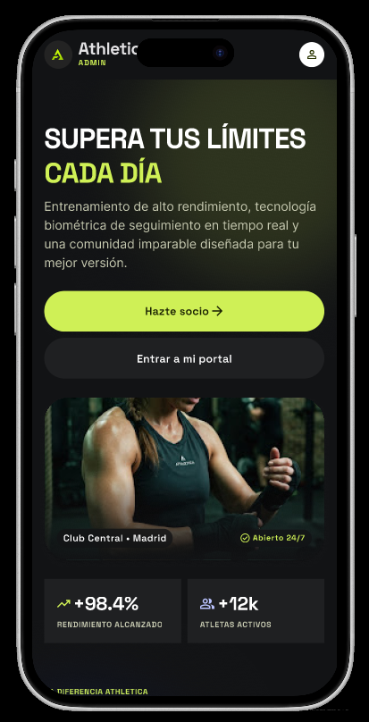
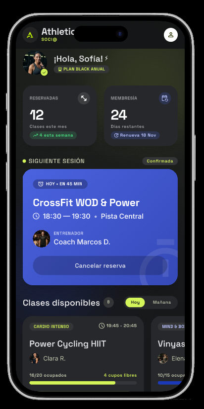
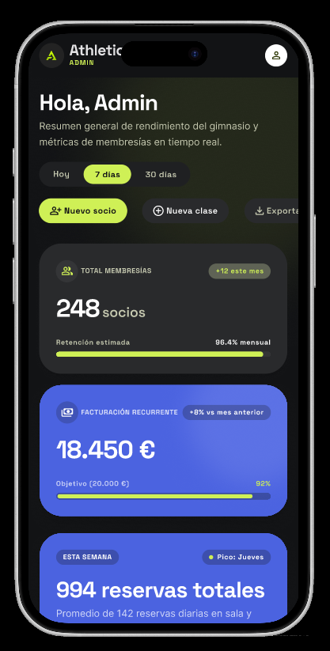
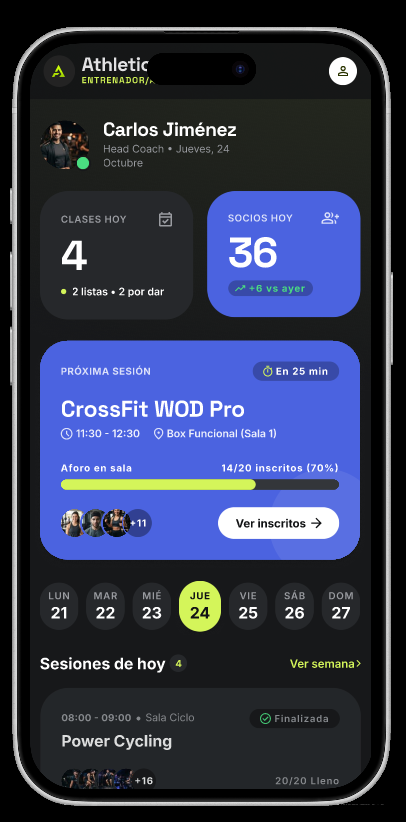
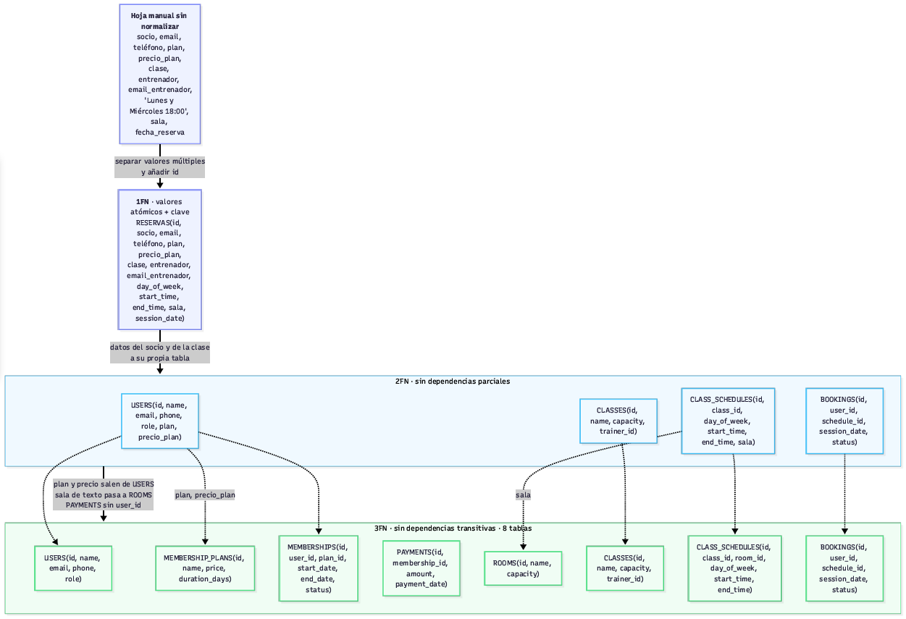

# Athletica

Aplicación de gestión de un gimnasio: socios, membresías, clases y reservas.
Monorepo con una API REST en FastAPI (`backend/`) y una web en React (`frontend/`).


## Demo en línea

Puedes probar la aplicación sin instalar nada: **[Athletica en Render](https://athletica-web.onrender.com/)**

- **API (Swagger de producción):** [https://athletica-api-w9f4.onrender.com/docs](https://athletica-api-w9f4.onrender.com/docs)
- **Vídeo de la demo:** [Athletica en YouTube](https://youtu.be/iQfdgkGfIYk)
- **Usuarios de prueba:** `admin@athletica.dev`, `trainer@athletica.dev` y `member@athletica.dev`, todos con la contraseña `Athletica123!`
- **Aviso:** la API gratuita de Render puede tardar entre 30 y 60 segundos en despertar tras la primera petición.

## Documentación

- **AGENTS.md:** instrucciones para agentes de trabajo en el repo.
- **specs/:** una spec por tarea, escrita antes del código (`<issue>-<slug>.md`).
- **docs/ai-log.md:** bitácora de uso de IA (herramienta, modelo, qué se aceptó/rechazó, errores del agente).
- **docs/errores.md:** catálogo de códigos y mensajes de error de la API.
- **docs/endpoints.md:** tablas de endpoints por recurso y las 5 reglas de negocio.
- **docs/deploy.md:** despliegue en Render.
- **docs/retrospectiva-parte2.md:** retrospectiva del equipo al final de la parte 2.
- **docs/comparativa-modelos-407.md:** comparativa de modelos gratuitos (tarea #407).
- **docs/postman/**: colección y entorno de Postman (incluye 2FA y GitHub OAuth).
- **docs/bruno/**: colección y entornos de Bruno.
- **Diagrama ER (Parte 2, actual):** [docs/er-diagram.md](docs/er-diagram.md) — Mermaid,
  9 tablas (añade `revoked_tokens` y auditoría en `users`).
- **Diagrama ER (Parte 1):** [docs/er-diagram.pdf](docs/er-diagram.pdf) _(Parte 1)_ —
  diseño relacional anterior.
- **Design tokens:** [docs/design-tokens.md](docs/design-tokens.md)
- **README del frontend:** [frontend/README.md](frontend/README.md)

## Capturas y diagramas

### Aplicación






### Base de datos relacional

Diagrama actual (Parte 2): [docs/er-diagram.md](docs/er-diagram.md).

Diagrama anterior (Parte 1): [docs/er-diagram.pdf](docs/er-diagram.pdf) _(Parte 1)_.
Captura del diagrama anterior:


## Requisitos

Instala esto una sola vez en tu equipo:

| Herramienta | Versión | Para qué | Comprobar |
| ----------- | ------- | -------- | --------- |
| Git | 2.40 o superior | Control de versiones | `git --version` |
| Python | 3.12 o superior | Backend (la CI usa 3.12) | `python --version` |
| Node.js | 22 LTS | Frontend (la CI usa 22); incluye `npm` | `node --version` |
| Docker | Desktop reciente | PostgreSQL en local | `docker --version` |

## Instalación

```bash
git clone https://github.com/IA-P1-BCN/g2-python-crud-api.git
cd g2-python-crud-api
```

### Backend

Desde la carpeta `backend/`:

**Windows (PowerShell)**

```powershell
cd backend
python -m venv .venv
.venv\Scripts\Activate.ps1
python -m pip install --upgrade pip
pip install -e ".[dev]"
Copy-Item .env.example .env
```

Si PowerShell no deja activar el entorno, ejecuta una vez
`Set-ExecutionPolicy -Scope CurrentUser RemoteSigned` y vuelve a intentarlo.

**macOS / Linux / Git Bash**

```bash
cd backend
python3 -m venv .venv
source .venv/bin/activate        # en Git Bash: source .venv/Scripts/activate
python -m pip install --upgrade pip
pip install -e ".[dev]"
cp .env.example .env
```

`pip install -e ".[dev]"` lee `backend/pyproject.toml` e instala:

- **Aplicación:** `fastapi[standard]`, `sqlalchemy`, `alembic`, `psycopg[binary]`,
  `pydantic-settings`, `pyjwt`, `pwdlib[argon2]`
- **Desarrollo:** `pytest`, `pytest-cov`, `ruff`, `pre-commit`

Para añadir una dependencia nueva, escríbela en `pyproject.toml` y vuelve a ejecutar
`pip install -e ".[dev]"`. No uses `pip install paquete` suelto: el resto del equipo no
lo tendría.

### Arranque del backend

Desde la carpeta `backend/`, con el entorno virtual activado:

1. Levanta la base de datos PostgreSQL:
   ```bash
   docker compose up -d db
   ```
2. Aplica las migraciones de Alembic:
   ```bash
   alembic upgrade head
   ```
3. Carga los datos de prueba:
   ```bash
   python -m app.db.seed
   ```
4. Arranca la API:
   ```bash
   uvicorn app.main:app --reload
   ```
   La API queda disponible en http://localhost:8000 y el Swagger en http://localhost:8000/docs.

Más detalles en [docs/docker.md](docs/docker.md).

Comprobar que todo está bien (con el entorno activado):

```bash
ruff check .        # debe decir "All checks passed!"
pytest              # 1352 tests, cobertura mínima del 80 %
```

Cada vez que abras una terminal nueva tienes que volver a activar el entorno virtual.

### Frontend

Desde la carpeta `frontend/`:

```bash
cd frontend
npm install
cp .env.example .env             # en PowerShell: Copy-Item .env.example .env
npm run dev                      # http://localhost:5173
```

Comprobar:

```bash
npm run lint
npm run test
```

Más detalle (scripts, estructura, tests E2E) en [frontend/README.md](frontend/README.md).

## Variables de entorno

### Backend (`backend/.env`)

| Variable | Descripción |
| -------- | ----------- |
| `DATABASE_URL` | Conexión PostgreSQL con psycopg 3 |
| `AUTO_CREATE_TABLES` | Crear tablas automáticamente (solo throwaway; dejar `false` con Alembic) |
| `SECRET_KEY` | Clave JWT |
| `ALGORITHM` | Algoritmo JWT (`HS256`) |
| `ACCESS_TOKEN_EXPIRE_MINUTES` | Duración del token de acceso |
| `REFRESH_TOKEN_EXPIRE_DAYS` | Duración del token de refresco en días |
| `CORS_ORIGINS` | Orígenes permitidos (CSV) |
| `LOGIN_RATE_LIMIT_ATTEMPTS` | Máximo de intentos de login por ventana |
| `LOGIN_RATE_LIMIT_WINDOW_SECONDS` | Ventana de tiempo del límite de login (segundos) |
| `EMAIL_VERIFICATION_EXPIRE_HOURS` | Horas de validez del enlace de verificación de email |
| `PASSWORD_RESET_EXPIRE_MINUTES` | Minutos de validez del enlace de recuperación de contraseña |
| `FRONTEND_URL` | URL del frontend para redirecciones OAuth y enlaces de los correos de verificación y recuperación |
| `GITHUB_CLIENT_ID` | ID de la aplicación GitHub OAuth |
| `GITHUB_CLIENT_SECRET` | Secreto de la aplicación GitHub OAuth |
| `GITHUB_REDIRECT_URI` | URI de callback de GitHub OAuth |
| `LOG_LEVEL` | Nivel de log |
| `LOG_FILE` | Fichero de log rotativo (vacío = solo consola) |

### Frontend (`frontend/.env`)

| Variable | Descripción |
| -------- | ----------- |
| `VITE_API_URL` | Base URL de la API (`/api/v1` en dev) |

## Estructura del repositorio

```text
.
├── AGENTS.md
├── CONTRIBUTING.md
├── render.yaml
├── specs/
├── docs/
├── .github/workflows/ci.yml   # CI: job de backend (ruff + pytest) y job de frontend
├── .github/workflows/ai-review.yml  # revisión automática con IA en los PR
├── backend/
│   ├── app/
│   │   ├── main.py            # crea la app FastAPI
│   │   ├── core/              # config, security (JWT y hash), logging, exceptions
│   │   ├── db/                # base, session, seed
│   │   ├── models/            # tablas SQLAlchemy, un archivo por tabla
│   │   ├── repositories/      # acceso a datos (SQL)
│   │   ├── schemas/           # schemas Pydantic, un archivo por recurso
│   │   ├── services/          # reglas de negocio
│   │   └── api/
│   │       ├── deps.py        # dependencias comunes: sesión, usuario actual, roles
│   │       └── v1/            # routers, un archivo por recurso
│   ├── alembic/               # migraciones de base de datos
│   ├── tests/
│   │   ├── conftest.py
│   │   ├── unit/              # tests de services
│   │   └── integration/       # tests de endpoints
│   ├── pyproject.toml
│   ├── Dockerfile
│   └── .env.example
└── frontend/              # React + Vite + TypeScript
    ├── src/
    │   ├── api/          # cliente HTTP
    │   ├── components/ui/{atoms,molecules,organisms}/
    │   ├── layouts/
    │   ├── pages/{admin,member,trainer,public}/
    │   ├── styles/       # theme.css (tokens)
    │   └── types/        # schema.d.ts generado
    ├── tests/{unit,e2e}/
    ├── package.json
    ├── Dockerfile
    └── .env.example
```

Capas del backend: el **router** recibe y responde, el **service** decide, el
**repository** lee y escribe y el **model** define la tabla. Las reglas de negocio
van siempre en `services/`. Los usuarios pasan siempre por
`app/repositories/user_repository.py`, cuyo cumplimiento enforcea un test.

## Cómo trabajamos

Guía completa en [CONTRIBUTING.md](CONTRIBUTING.md).


- **Idioma:** código, nombres y comentarios en inglés; documentación en español.
- **Ramas:** se crean desde la tarea en GitHub (siempre base `dev`). El nombre que
  se genera queda `<numero>-<título>` (por ejemplo
  `414-social-login-with-oauth2-google-or-github`). Nunca se crean manualmente.

- **Commits:** [Conventional Commits](https://www.conventionalcommits.org/es/):
  `feat(bookings): ...`, `fix: ...`, `test(auth): ...`, `docs: ...`, `refactor: ...`,
  `chore: ...`.
- **Pull requests:** pequeños (una historia o menos), con `Closes #N`, CI en verde y revisión
  humana, con la opcion C: si hay alguien conectado, se le añade en **Reviewers** y
  esa persona aprueba con un comentario y fusiona; si no, se revisa el propio PR
  (`Files changed` -> `Submit review` -> **Comment**) antes de fusionar. Cada PR recibe un
  comentario automatico *AI review* (Gemini) que solo orienta y no sustituye la
  revisión humana.

- **Secretos:** `.env` nunca se sube. Si añades una variable, añádela también a
  `.env.example` con un valor ficticio.

## Equipo

Contribuidores de GitHub:

- [@elenaalmansacampos](https://github.com/elenaalmansacampos)
- [@miskybox](https://github.com/miskybox)
- [@nagicome03](https://github.com/nagicome03)
- [@PDguezPgr](https://github.com/PDguezPgr)
