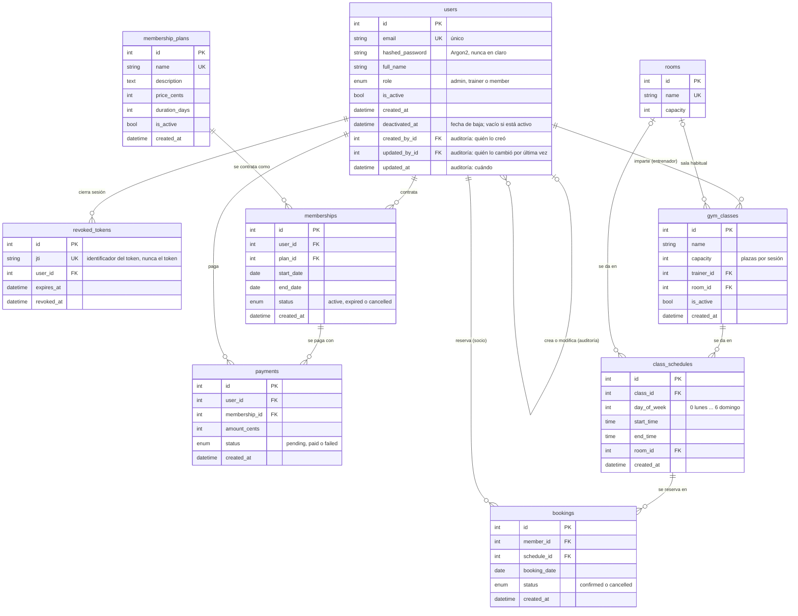

# Diagrama ER de Athletica

Base de datos PostgreSQL con **9 tablas**, a fecha del 15 de octubre de 2026. Este diagrama
sustituye al de la parte 1 (`docs/er-diagram.pdf` y `docs/screenshots/er-diagram.png`), que no
tiene la tabla `revoked_tokens` ni las columnas de auditoría de `users`.

Está escrito en [Mermaid](https://mermaid.js.org/), así que se puede editar como texto y GitHub lo
dibuja al abrir este archivo. Coincide con las migraciones de Alembic hasta la `d7e2b5a9c1f3`.

## Relaciones

| De | A | Tipo | Columna |
| --- | --- | --- | --- |
| `users` | `memberships` | 1 a N | `memberships.user_id` |
| `membership_plans` | `memberships` | 1 a N | `memberships.plan_id` |
| `memberships` | `payments` | 1 a N | `payments.membership_id` |
| `users` | `payments` | 1 a N | `payments.user_id` |
| `users` (entrenador) | `gym_classes` | 1 a N | `gym_classes.trainer_id` |
| `rooms` | `gym_classes` | 0..1 a N | `gym_classes.room_id` (opcional) |
| `gym_classes` | `class_schedules` | 1 a N | `class_schedules.class_id` |
| `rooms` | `class_schedules` | 0..1 a N | `class_schedules.room_id` |
| `class_schedules` | `bookings` | 1 a N | `bookings.schedule_id` |
| `users` (socio) | `bookings` | 1 a N | `bookings.member_id` |
| `users` | `revoked_tokens` | 1 a N | `revoked_tokens.user_id` |
| `users` | `users` | 0..1 a N | `users.created_by_id` y `users.updated_by_id` (auditoría) |

## Reglas que no se ven en el diagrama

Las garantiza el código, no la base de datos:

- **Un horario siempre tiene sala.** En la tabla `class_schedules.room_id` admite vacío, pero la
  API no deja crear ni dejar un horario sin sala.
- **El rol del entrenador.** `gym_classes.trainer_id` debe apuntar a un usuario con rol
  `trainer`; lo comprueba el servicio de clases.
- **Un pago es de la membresía de su usuario.** `payments.user_id` repite el usuario que ya se
  deduce de `payments.membership_id`; el servicio de pagos comprueba que coincidan. Es la única
  redundancia del modelo.
- **No se borra nada de lo que dependan otros datos** (planes con membresías, salas en uso, clases
  con horarios, horarios con reservas, membresías con pagos): la API responde 409.
- **Los usuarios no se borran**, se desactivan con fecha de baja.

## Cambios respecto a la parte 1

| Cambio | Tarea | Migración |
| --- | --- | --- |
| Tabla nueva `revoked_tokens` | #408 | `c41f8a2d9b07` |
| Columnas de auditoría en `users`: `created_by_id`, `updated_by_id`, `updated_at` | #410 | `d7e2b5a9c1f3` |
